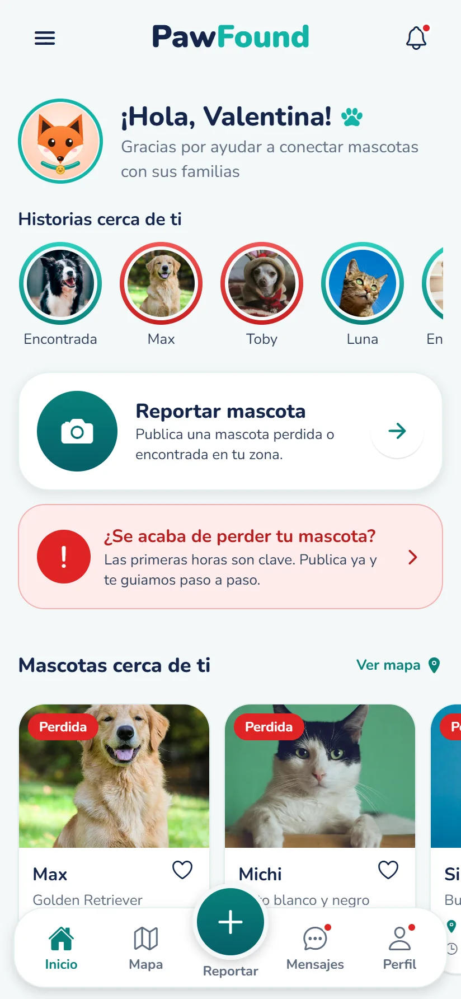
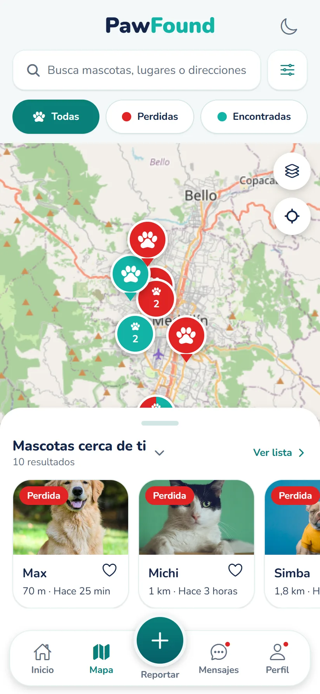
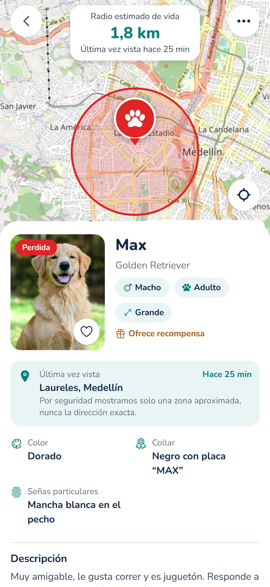
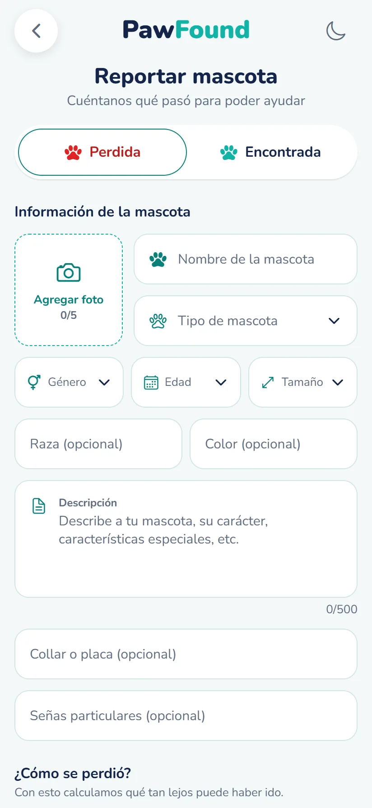
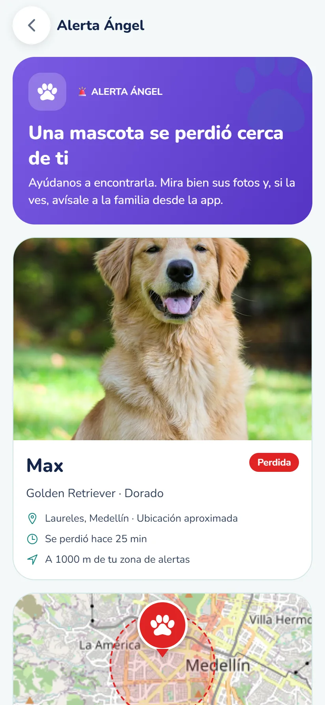
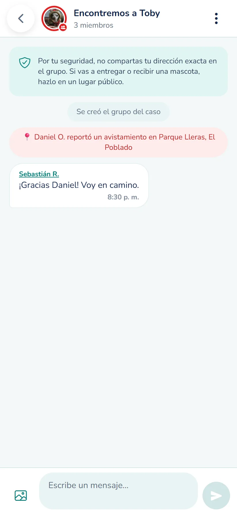
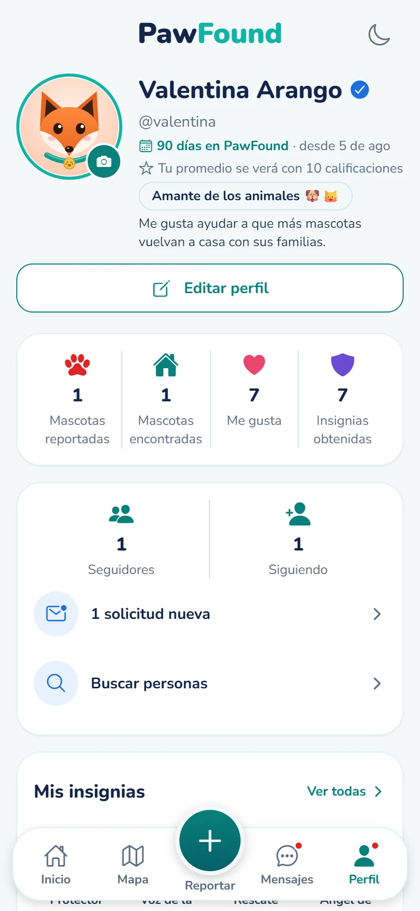
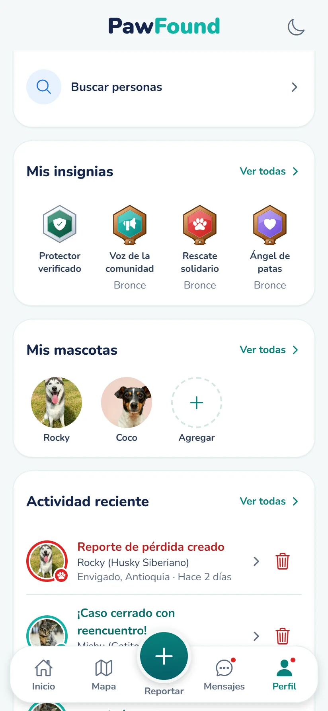
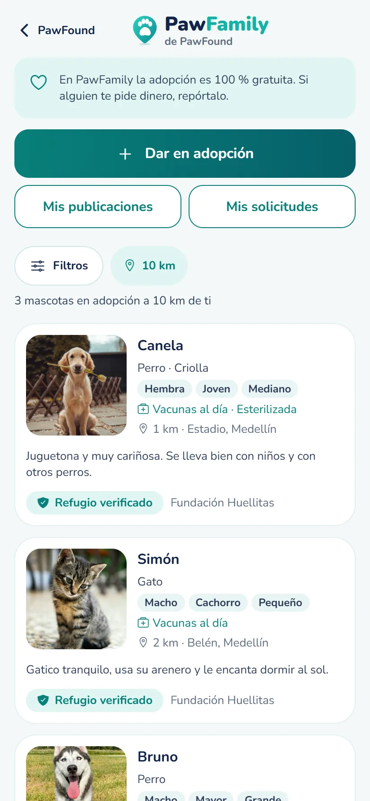

<p align="center">
  
</p>

# PawFound

<p align="center">
  <a href="https://github.com/TomasPosada0626/PawFound/actions/workflows/ci.yml"></a>
  <a href="https://github.com/TomasPosada0626/PawFound/actions/workflows/quality.yml"></a>
  <a href="LICENSE"></a>
</p>

<p align="center">
  
  
  
  
  
  
  
  <br />
  
  
  
  
  
  
</p>

PawFound es una app comunitaria y gratuita de Colombia para reportar mascotas perdidas o
encontradas y reunirlas con su familia. Incluye **PawFamily**, la sección de adopción
responsable y gratuita.

> **Estado:** piloto en Android. La app se instala como APK y recibe actualizaciones sin
> reinstalar (EAS Update). La API, la base de datos y el sitio web
> ([pawfound.pages.dev](https://pawfound.pages.dev)) están en producción con capas gratuitas.

## La app

<table>
  <tr>
    <td align="center" width="33%"><br /><b>Inicio</b><br /><sub>Historias, reportar y casos cercanos</sub></td>
    <td align="center" width="33%"><br /><b>Mapa</b><br /><sub>Perdidas en rojo, encontradas en aguamarina</sub></td>
    <td align="center" width="33%"><br /><b>Caso y círculo de vida</b><br /><sub>Zona aproximada, nunca la dirección</sub></td>
  </tr>
  <tr>
    <td align="center"><br /><b>Reportar</b><br /><sub>Perdida o encontrada, de 1 a 5 fotos</sub></td>
    <td align="center"><br /><b>Alerta Ángel</b><br /><sub>Aviso a quien está cerca</sub></td>
    <td align="center"><br /><b>Grupo del caso</b><br /><sub>«Encontremos a…» con avistamientos</sub></td>
  </tr>
  <tr>
    <td align="center"><br /><b>Perfil</b><br /><sub>Reputación, seguidores y me gusta</sub></td>
    <td align="center"><br /><b>Insignias y Mis mascotas</b><br /><sub>Medallas que se ganan ayudando</sub></td>
    <td align="center"><br /><b>PawFamily</b><br /><sub>Adopción gratuita y refugios verificados</sub></td>
  </tr>
</table>

<sub>Capturas de la app en modo demostración, con personas, casos y chats de ejemplo y fotos de
<a href="https://unsplash.com/license">Unsplash</a>. Se tomaron de la versión web de la app; en
Android el mapa es Google Maps. Cómo regenerarlas: <a href="assets/capturas/">assets/capturas/</a>.</sub>

## Propósito

Reducir el tiempo entre la pérdida de una mascota y su reencuentro, con reportes claros,
búsqueda por zona y una comunidad que coordina sin exponer datos sensibles.

## Principios

- Bienestar y seguridad animal primero.
- Información verificable y comunicación respetuosa.
- Protección de datos personales y de ubicación: nunca se muestra una dirección exacta por defecto.
- Gratis, sin publicidad y sin vender datos.

## Qué hace

La app tiene cinco pestañas (**Inicio**, **Mapa**, **Reportar** `+`, **Mensajes** y **Perfil**),
y **PawFamily** se abre desde Inicio. Se puede explorar sin cuenta; para reportar, escribir o
adoptar se pide una cuenta con el correo verificado.

### Inicio y Mapa

- Casos cercanos en vivo, historias de los casos, personas conectadas y «Nuestro impacto» de la ciudad.
- Mapa con todas las mascotas reportadas, filtros y capa de veterinarias. Al tocar una, se ve
  solo ella con su círculo.
- **Veterinarias** cercanas desde OpenStreetMap, con ruta en Waze o Google Maps.

### Reportar y el caso

- Reportar una mascota perdida o encontrada desde el botón `+`: hasta 2 reportes por día.
- **Círculo de vida**: el radio de búsqueda de una perdida arranca en 250 m y llega a 2 km en
  unos 30 minutos. Una encontrada usa el radio que elige quien la reporta.
- Avistamientos («La vi»), historias del caso, afiche con QR, historia para Instagram y página
  pública para compartir (`pawfound.pages.dev/mascota/<id>`).
- **Recordatorios**: a los 3, 7 y 14 días se pregunta a la familia si su mascota apareció. Un
  caso sin novedades se archiva a los 60 días, con aviso una semana antes.
- Solo quien abrió el caso lo cierra; al hacerlo agradece y califica a quienes ayudaron.

### Alertas y avisos

- **Alerta Ángel**: notificación push a los celulares cerca del caso, también con la app cerrada
  mientras la sesión siga abierta. A medida que el círculo crece, llega a más personas.
- **Coincidencias**: una encontrada que se parece a una perdida cercana, o a una de «Mis
  mascotas» («¿Es Rocky?»), avisa a su familia.
- Avisos a quienes te siguen cuando se pierde tu mascota y cuando aparece.

### Mensajes

- Cada caso crea su grupo («Encontremos a…»). También hay mensajes directos, con fotos y
  ubicación puntual (nunca en vivo).
- Al cerrar el caso se cierran su grupo y sus mensajes directos.
- Sin bloqueos: se reporta a la persona y moderación decide.

### Perfil y comunidad

- Perfil público con días en PawFound, «me gusta», seguidores y calificación. El promedio se ve
  desde la décima calificación.
- Seguirse con solicitud aceptada y buscar personas por usuario.
- **Insignias** por niveles, que se ganan ayudando.
- **Mis mascotas**: si una se pierde, el reporte sale ya lleno.
- Exportar los datos y eliminar la cuenta, que borra todo.

### PawFamily: adopción

- Buscar mascotas en adopción por distancia, especie, sexo, tamaño y edad, o publicar una.
- Solicitud con los datos del hogar. Quien publica acepta o rechaza, y al aceptar se abre un
  chat. Una solicitud sin respuesta vence a los 14 días.
- Seguimiento: a los 7 y 30 días se le pide a la nueva familia una foto de cómo está.
- **Refugios verificados** automáticamente con el RUES de Confecámaras, con perfil público.
- 100 % gratuita: pedir dinero se reporta y moderación puede vetar la cuenta.

Moderación trabaja desde un panel web (`/admin`) servido por la API. El detalle funcional vive en
[PRODUCT.md](PRODUCT.md).

## Cómo está hecho

```text
apps/api      API en Go: chi, pgx, PostgreSQL + PostGIS, WebSockets, panel /admin y tareas periódicas
apps/mobile   App Expo (React Native + TypeScript + NativeWind), Android primero
apps/web      Sitio en Astro con una función de Cloudflare Pages para los casos compartidos
packages/     Contrato OpenAPI y vectores de prueba compartidos por la app y la API
infra/        Docker Compose para PostgreSQL + PostGIS en local
scripts/      Respaldo y restauración cifrados de la base de datos
assets/       Logo y capturas de la app
docs/         Arquitectura, despliegue, legal, accesibilidad, flujos e investigación
```

En producción: API en Render, base de datos en Neon, fotos en Cloudflare R2, sitio en
Cloudflare Pages, correo por Brevo y notificaciones por el servicio push de Expo. Detalle en
[docs/ARCHITECTURE.md](docs/ARCHITECTURE.md) y [docs/DESPLIEGUE.md](docs/DESPLIEGUE.md).

## Empezar en local

```bash
docker compose -f infra/docker-compose.yml up -d   # PostgreSQL + PostGIS
```

Luego sigue el README de cada parte: [API](apps/api/README.md), [app](apps/mobile/README.md)
y [sitio web](apps/web/README.md). La app también corre sin API, en modo demostración.

## Documentación

| Documento | Para qué |
| --- | --- |
| [PRODUCT.md](PRODUCT.md) | Usuarios, propósito, reglas de producto y decisiones |
| [docs/ARCHITECTURE.md](docs/ARCHITECTURE.md) | Cómo encajan la app, la API, la web y los proveedores |
| [docs/DESPLIEGUE.md](docs/DESPLIEGUE.md) | Publicar y operar con capas gratuitas, respaldos y comandos |
| [packages/contracts/](packages/contracts/) | Contrato HTTP (OpenAPI) y vectores de prueba compartidos |
| [docs/legal/](docs/legal/) | Política de privacidad, términos, consentimientos, moderación y proveedores |
| [docs/accesibilidad.md](docs/accesibilidad.md) | Estándar de accesibilidad (WCAG 2.1 AA + Material) |
| [docs/PROJECT_MANAGEMENT.md](docs/PROJECT_MANAGEMENT.md) | Ramas, etiquetas, fases y definición de terminado |
| [docs/flujos/](docs/flujos/), [docs/investigacion/](docs/investigacion/) y [Diseño ideal/](Dise%C3%B1o%20ideal/) | Flujos, investigación y mockups del diseño original (historia del proyecto) |

## Participar

Consulta [CONTRIBUTING.md](CONTRIBUTING.md) para colaborar,
[CODE_OF_CONDUCT.md](CODE_OF_CONDUCT.md) para las normas de convivencia,
[SECURITY.md](SECURITY.md) para reportar vulnerabilidades y [SUPPORT.md](SUPPORT.md) para pedir ayuda.

## Licencia

[MIT](LICENSE) © 2026 Tomás Posada.
