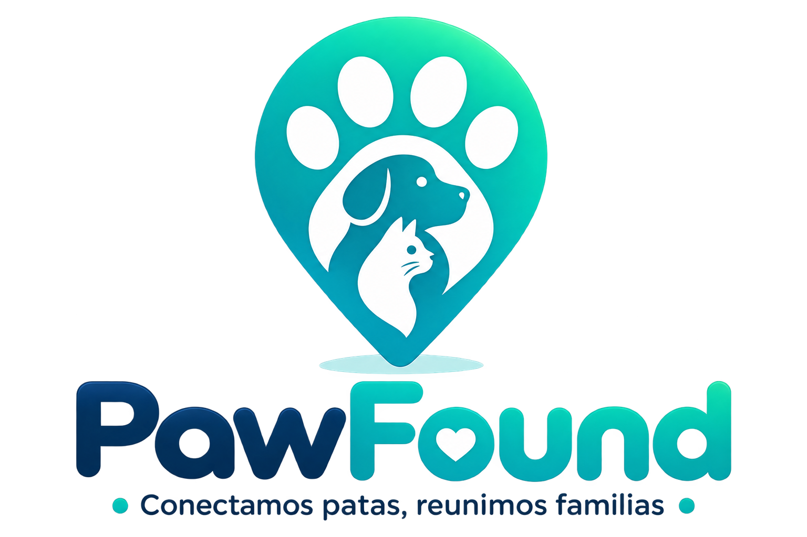

<p align="center">
  
</p>

# PawFound

<p align="center">
  <a href="https://github.com/TomasPosada0626/PawFound/actions/workflows/ci.yml"></a>
  <a href="https://github.com/TomasPosada0626/PawFound/actions/workflows/quality.yml"></a>
  <a href="LICENSE"></a>
</p>

<p align="center">
  
  
  
  
  
  
  
  <br />
  
  
  
  
  
  
</p>

PawFound es una app comunitaria y gratuita de Colombia para reportar mascotas perdidas o
encontradas y reunirlas con su familia. Incluye **PawFamily**, la sección de adopción
responsable y gratuita.

> **Estado:** piloto en Android. La app se instala como APK y recibe actualizaciones sin
> reinstalar (EAS Update). La API, la base de datos y el sitio web
> ([pawfound.pages.dev](https://pawfound.pages.dev)) están en producción con capas gratuitas.

<p align="center">
  
  
  
</p>
<p align="center"><sub>Diseño de referencia de <a href="Dise%C3%B1o%20ideal/">Diseño ideal/</a>; la app ya implementada lo sigue y lo amplía.</sub></p>

## Propósito

Reducir el tiempo entre la pérdida de una mascota y su reencuentro, con reportes claros,
búsqueda por zona y una comunidad que coordina sin exponer datos sensibles.

## Principios

- Bienestar y seguridad animal primero.
- Información verificable y comunicación respetuosa.
- Protección de datos personales y de ubicación: nunca se muestra una dirección exacta por defecto.
- Gratis, sin publicidad y sin vender datos.

## Qué hace

### PawFound: perdidas y encontradas

- **Cuentas verificadas por correo**: registro con correo, nombre, usuario y contraseña; un
  código de 6 dígitos verifica el correo y da la insignia azul. Sin SMS ni inicio de sesión
  con Google o Apple.
- **Mapa e inicio** con los casos cercanos en vivo. Se puede explorar sin cuenta.
- **Reportar** una mascota perdida o encontrada desde el botón `+` (máximo 2 por día).
- **Círculo de vida**: el radio de búsqueda de una mascota perdida arranca en 250 m y llega a
  2 km en unos 30 minutos. Una encontrada usa el radio que elige quien la reporta.
- **Alerta Ángel**: notificación push a los celulares cerca del caso, también con la app
  cerrada mientras la sesión siga abierta. A medida que el círculo crece, llega a más personas.
- **Chats**: cada caso crea su grupo («Encontremos a…»), hay mensajes directos con fotos y
  ubicación puntual (nunca en vivo), y los chats del caso se cierran al cerrarlo.
- **Coincidencias**: una mascota encontrada que se parece a una perdida cercana, o a una de
  «Mis mascotas» («¿Es Rocky?»), avisa a su familia. Mientras el círculo crece, se vuelve a comparar.
- **Recordatorios**: a los 3, 7 y 14 días se le pregunta a la familia si su mascota apareció;
  un caso sin novedades se archiva a los 60 días, con aviso una semana antes.
- **Comunidad**: perfiles públicos, seguirse con solicitud aceptada, «me gusta»,
  calificaciones de ayuda (el promedio se ve desde la décima) e insignias por ayudar.
- **Historias** del caso, historia para Instagram, afiche con QR y página pública del caso
  para compartir (`pawfound.pages.dev/mascota/<id>`).
- **Veterinarias** cercanas desde OpenStreetMap, con ruta en Waze o Google Maps.

### PawFamily: adopción

- Publicar y buscar mascotas en adopción por distancia, especie, sexo, tamaño y edad.
- Solicitud de adopción con datos del hogar; quien publica acepta o rechaza y se abre un chat.
  Una solicitud sin respuesta vence a los 14 días.
- Seguimiento: a los 7 y 30 días se le pide a la nueva familia una foto de cómo está.
- **Refugios verificados** automáticamente con el RUES de Confecámaras, con perfil público.
- 100 % gratuita: pedir dinero se reporta y moderación puede vetar la cuenta.

**Privacidad y control**: exportar los datos y eliminar la cuenta (borra todo) desde la app,
y un panel de moderación web (`/admin`) sin bloqueos entre personas: se reporta y moderación decide.

El detalle funcional vive en [PRODUCT.md](PRODUCT.md).

## Cómo está hecho

```text
apps/api      API en Go: chi, pgx, PostgreSQL + PostGIS, WebSockets, panel /admin y tareas periódicas
apps/mobile   App Expo (React Native + TypeScript + NativeWind), Android primero
apps/web      Sitio en Astro con una función de Cloudflare Pages para los casos compartidos
packages/     Contrato OpenAPI y vectores de prueba compartidos por la app y la API
infra/        Docker Compose para PostgreSQL + PostGIS en local
scripts/      Respaldo y restauración cifrados de la base de datos
docs/         Arquitectura, despliegue, legal, accesibilidad, flujos e investigación
```

En producción: API en Render, base de datos en Neon, fotos en Cloudflare R2, sitio en
Cloudflare Pages, correo por Brevo y notificaciones por el servicio push de Expo. Detalle en
[docs/ARCHITECTURE.md](docs/ARCHITECTURE.md) y [docs/DESPLIEGUE.md](docs/DESPLIEGUE.md).

## Empezar en local

```bash
docker compose -f infra/docker-compose.yml up -d   # PostgreSQL + PostGIS
```

Luego sigue el README de cada parte: [API](apps/api/README.md), [app](apps/mobile/README.md)
y [sitio web](apps/web/README.md). La app también corre sin API, en modo demostración.

## Documentación

| Documento | Para qué |
| --- | --- |
| [PRODUCT.md](PRODUCT.md) | Usuarios, propósito, reglas de producto y decisiones |
| [docs/ARCHITECTURE.md](docs/ARCHITECTURE.md) | Cómo encajan la app, la API, la web y los proveedores |
| [docs/DESPLIEGUE.md](docs/DESPLIEGUE.md) | Publicar y operar con capas gratuitas, respaldos y comandos |
| [packages/contracts/](packages/contracts/) | Contrato HTTP (OpenAPI) y vectores de prueba compartidos |
| [docs/legal/](docs/legal/) | Política de privacidad, términos, consentimientos, moderación y proveedores |
| [docs/accesibilidad.md](docs/accesibilidad.md) | Estándar de accesibilidad (WCAG 2.1 AA + Material) |
| [docs/PROJECT_MANAGEMENT.md](docs/PROJECT_MANAGEMENT.md) | Ramas, etiquetas, fases y definición de terminado |
| [docs/flujos/](docs/flujos/) e [docs/investigacion/](docs/investigacion/) | Diseño de flujos e investigación inicial (historia del proyecto) |

## Participar

Consulta [CONTRIBUTING.md](CONTRIBUTING.md) para colaborar,
[CODE_OF_CONDUCT.md](CODE_OF_CONDUCT.md) para las normas de convivencia,
[SECURITY.md](SECURITY.md) para reportar vulnerabilidades y [SUPPORT.md](SUPPORT.md) para pedir ayuda.

## Licencia

[MIT](LICENSE) © 2026 Tomás Posada.
